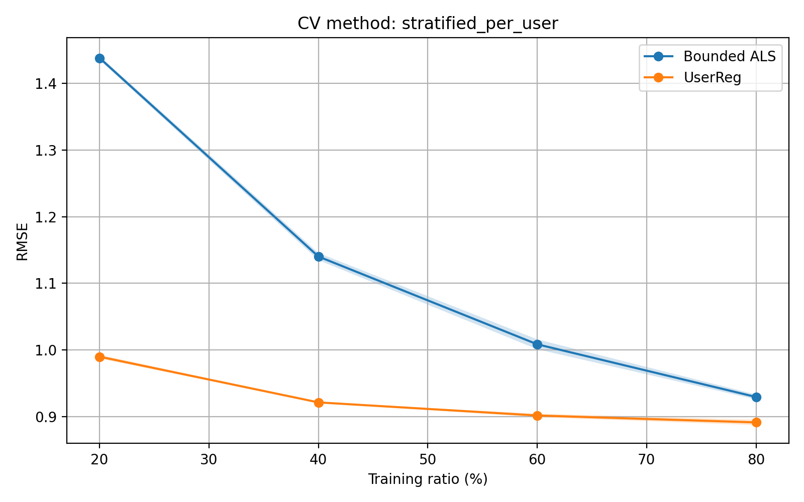

# Movie recommendation: matrix factorization and HERec

Predicting missing movie ratings from a sparse user–movie matrix, comparing constrained matrix factorization with two methods from the literature: UserReg and HERec.

Team project by Barthélémy Charlier, Benjamin Séguin and Marius Henry (M.Sc. IASD, Université PSL, 2025). The full write-up is in [`report.pdf`](report.pdf).

## Problem

The data is a 610 × 4,980 user–movie rating matrix built from MovieLens (`ml-latest-small`), with ratings from 0.5 to 5 and more than 98% of entries missing. Movie genres and release years are available as side information.

## Methods

1. **ALS baselines.** Alternating least squares, then two constrained variants: non-negative factors (ANNLS) and factors bounded so that predictions stay in the rating range (BNNLS). See `als.py` and `functions/vanilla_als.py`.
2. **UserReg** ([Zhang et al., 2021](https://arxiv.org/abs/2102.07601)). Matrix factorization with a regularizer that keeps each user's predictions consistent with their own rating behaviour. See `userreg.py`.
3. **HERec** ([Shi et al., 2017](https://arxiv.org/abs/1711.10730)). Builds a heterogeneous graph of users, movies, genres and release years, and adds it to matrix factorization in four steps:
   - random walks along meta-paths (UMU, MUM, MYM, UMYMU, UMGMU), in `meta_path_utils.py`;
   - skip-gram embeddings of the walks, our own node2vec implementation in PyTorch Lightning, in `skipgram_light.py`;
   - a personalized non-linear fusion of the embeddings from each meta-path;
   - an extended matrix factorization model that uses the fused embeddings, trained with SGD, in `HERec.py`.

   The full pipeline runs in `notebooks/embed.ipynb`.

## Results

Test RMSE with the best hyperparameters for each model:

| Model | RMSE |
|---|---|
| BNNLS (bounded ALS) | 0.9146 |
| UserReg | 0.8797 |
| HERec | **0.8740** |

Models were evaluated with a stratified per-user holdout, at four training ratios (20–80%) and three seeds each. HERec and UserReg beat bounded ALS at every training ratio.



## Repository layout

```
generate.py                 completes a rating matrix with UserReg (entry point)
als.py, functions/          ALS baselines and helpers
userreg.py                  UserReg
meta_path_utils.py          graph construction and meta-path random walks
skipgram.py                 skip-gram with negative sampling (PyTorch)
skipgram_light.py           same, in PyTorch Lightning (used for the final embeddings)
HERec.py                    HERec model
notebooks/                  data exploration, UserReg tuning, HERec pipeline
experiments/                baseline tests, cross-validation and grid searches
results/, grid_search_results/   figures and CSVs reported in the write-up
```

## Running it

```bash
pip install -r requirements.txt
python generate.py --name data/ratings_train.npy   # writes output.npy
```

Run the scripts in `experiments/` from the repository root, for example `python experiments/test_annls.py`.

**Data is not included.** The scripts expect `data/ratings_train.npy` and `data/ratings_test.npy` (users × movies, `NaN` for missing ratings) and `data/namesngenre.npy` (movie titles and genres). They were built from [MovieLens `ml-latest-small`](https://grouplens.org/datasets/movielens/), which is distributed by GroupLens under its own terms.

`experiments/professional_compare_methods.py` also needs the HERec embeddings produced by `notebooks/embed.ipynb`.
